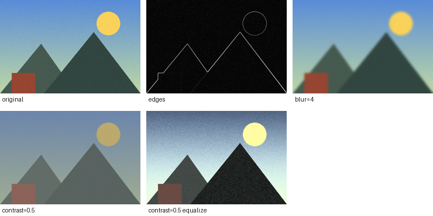

# image-editor

[](https://github.com/AnyaTahmasian/image-editor/actions/workflows/ci.yml)

A command line image editor in C++17. All the image processing (blur, edge detection,
resizing, histogram equalization...) is implemented from scratch, without OpenCV.
The only library used is [stb](https://github.com/nothings/stb) for reading and writing PNG/JPEG files.

I wrote it to understand how the filters in photo editors actually work, and to practice
C++, CMake and testing.



## Features

- **Color:** grayscale, brightness, contrast, invert, threshold, histogram equalization
- **Filters:** gaussian blur (separable), box blur, sharpen (unsharp mask), Sobel edge detection, general 2D convolution
- **Geometry:** resize (bilinear and nearest neighbor), rotate 90°, flip, crop

Operations can be chained and run left to right:

```bash
./build/imgedit photo.jpg out.png resize=800x600 blur=1.5 contrast=1.2
./build/imgedit photo.jpg edges.png edges
./build/imgedit photo.jpg small.jpg crop=100,50,400,300 rotate
./build/imgedit --help
```

## Build

Needs CMake 3.16+ and a C++17 compiler (tested with clang and gcc).

```bash
cmake -B build
cmake --build build
./build/imgedit_tests     # run the tests
./build/imgedit_bench     # blur benchmark
```

On macOS, CMake can be installed with `brew install cmake`.

## How some of it works

**Gaussian blur.** Each output pixel is a weighted average of its neighbors, with weights from
a bell curve. A 2D gaussian kernel is the product of two 1D kernels, so instead of one k×k pass
I do a horizontal pass and then a vertical pass. That's 2k multiplications per pixel instead of k².
The tests check that both versions give the same image, and `imgedit_bench` measures the difference
(512×512 RGB, Release build):

| sigma | kernel | 2D convolution | separable | speedup |
|---|---|---|---|---|
| 1 | 7×7 | 126 ms | 36 ms | 3.5× |
| 2 | 13×13 | 385 ms | 57 ms | 6.8× |
| 4 | 25×25 | 1496 ms | 109 ms | 13.8× |
| 8 | 49×49 | 6034 ms | 229 ms | 26.4× |

The speedup grows with the kernel size, as expected (roughly k/2).

**Bilinear resize.** For each output pixel I find where it lands in the source image, which is
usually between four pixels, and mix those four by distance: first along x, then along y.

**Sobel edges.** Two 3×3 kernels estimate how fast brightness changes in x and in y.
The edge strength is the length of that gradient vector.

**Histogram equalization.** Uses the cumulative histogram of brightness to spread out levels that
are bunched together, which brings back contrast in flat images.

**Borders.** When a filter reads outside the image, the nearest edge pixel is used (clamping),
so the filters don't need special cases at the edges.

Images are stored as floats in [0, 1] so that chaining several filters doesn't add up rounding errors.

## Tests

37 tests in `tests/`, using a small test framework in `tests/test.hpp` (so there are no extra
dependencies). They check things like: blurring a flat image changes nothing, rotating four times
gives back the original, Sobel finds a vertical edge, bilinear downscaling averages 2×2 blocks,
and invalid input gives an error instead of a crash.

GitHub Actions builds and tests on Linux (gcc) and macOS (clang), and runs the tests once more with
AddressSanitizer and UndefinedBehaviorSanitizer to catch memory bugs.

## Project structure

```
include/imgedit/   headers (image.hpp, ops.hpp, cli.hpp)
src/               image.cpp (load/save), adjust.cpp, filters.cpp, transform.cpp, cli.cpp, main.cpp
tests/             tests for each part
bench/             blur benchmark
third_party/stb/   stb_image and stb_image_write
```

## TODO

- [ ] rotate by any angle
- [ ] median filter for noise
- [ ] use multiple threads for the filters
